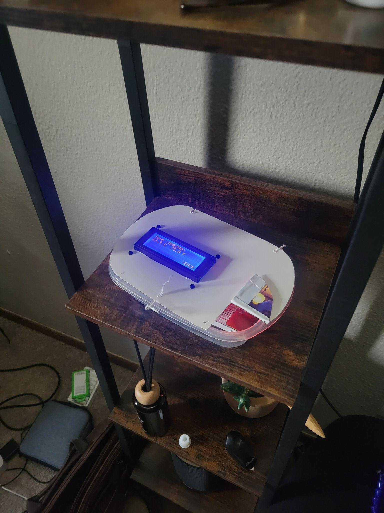

# Indoor Air Monitor

A battery-powered ESP32 monitor for the non-particulate parts of indoor air: temperature, humidity, pressure, eCO₂, and TVOC. It combines the readings into three 0–100 scores (Asthma, Sleep, and Freshness), shows them on a 20×4 LCD, and logs them to ThingSpeak over WiFi.

Built for ELEE 4230 (Sensors and Transducers) at the University of Georgia, 2026. Solo project.



## Hardware

| Part | Role |
| --- | --- |
| ESP32 dev board | Microcontroller, WiFi, touch input, 12-bit ADC |
| 10 kΩ NTC thermistor | Raw temperature sensor with a custom analog front end |
| BME280 | Temperature, humidity, pressure (I²C, 0x76) |
| SGP30 | eCO₂ and TVOC (I²C, 0x58) |
| Copper-tape pad | Homemade capacitive touch input on GPIO27 |
| 20×4 LCD with I²C backpack | Display and menu |
| 6×AA NiMH + LM2596 buck | Power, regulated to 5.0 V |

Total parts cost was about $88.

## Thermistor front end

The thermistor goes through a parallel resistor (7.46 kΩ) to linearize it, a bias divider, a TL071 gain stage (gain ≈ 8.7, referenced to 3.5 V, with low-pass filtering), and a ×0.40 divider so the ADC never sees more than 3.3 V. It's read on GPIO32, because the ESP32's second ADC is disabled while WiFi is on.

- Calibrated with 80 resistance-temperature readings from 1.3 to 61 °C: β = 3992 K, R₂₅ = 10.21 kΩ, R² = 0.9995
- A 1-D Kalman filter at 5 Hz (Q = 0.0008, R = 0.15) cut sample-to-sample noise from ±0.42 °C to ±0.02 °C
- Agrees with the BME280 to within 0.55 °C on average (1.22 °C worst case) over 12 minutes

## Scores

Each measurement gets a 0–100 subscore based on how close it is to an ideal range. Each index is a weighted average of its four subscores.

| Measurement | Asthma weight | Sleep weight | Freshness weight |
| --- | --- | --- | --- |
| TVOC | 0.35 | 0.10 | 0.45 |
| eCO₂ | 0.25 | 0.25 | 0.45 |
| Temperature | 0.20 | 0.35 | 0.05 |
| Humidity | 0.20 | 0.30 | 0.05 |

Above 79 is Good, 50–79 is Average, below 50 is Poor.

Moving the unit from my bedroom to the kitchen after cooking:

| Index | Bedroom | Kitchen | Change |
| --- | --- | --- | --- |
| Asthma | 86 | 39 | −47 |
| Sleep | 65 | 44 | −21 |
| Freshness | 97 | 53 | −44 |

## Controls

The copper pad is the only input. Tap to cycle, hold for 1.5 s to select or go back. Menus: Asthma, Sleep, Freshness, and raw measurements.

## Repository layout

```
indoor-air-monitor/
├── README.md
├── firmware/
│   └── airquality/
│       └── airquality.ino
├── hardware/
│   ├── kicad/              # .kicad_pro, .kicad_sch, .kicad_pcb
│   └── schematic.pdf
├── data/
│   ├── thermistor_calibration.csv
│   └── thingspeak_export.csv
└── docs/
    ├── report.pdf
    ├── BOM.md
    └── images/
```

## Building

1. Install the Arduino IDE with ESP32 board support.
2. Install the Adafruit BME280, Adafruit SGP30, LiquidCrystal_I2C, and ThingSpeak libraries.
3. Put your WiFi credentials and ThingSpeak API key in `firmware/airquality/secrets.h` (not committed).
4. Upload `airquality.ino` to the ESP32.

## Limitations

- The SGP30 reports changes relative to a baseline, not true concentrations. eCO₂ is an estimate, not a real CO₂ measurement.
- The Sleep index can't go above 65 when the room is 23 °C or warmer, because the temperature subscore drops to zero there.

## Documentation

Full report: [docs/report.pdf](docs/report.pdf)
